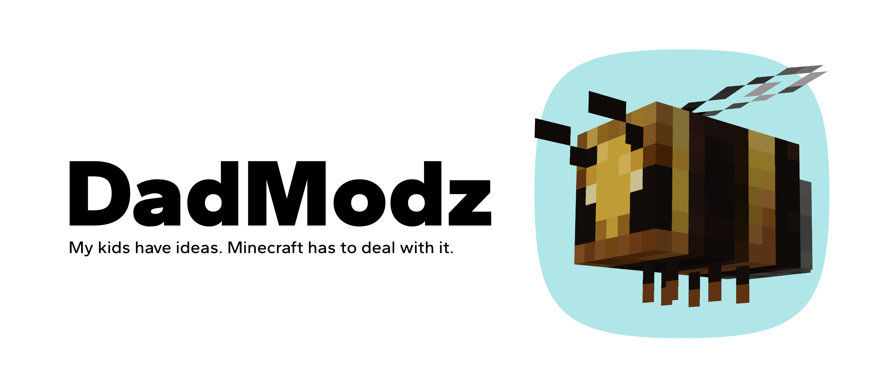

# DadModz

Minecraft Bedrock add-ons by DadModz: a pet bee, a pickaxe that tunnels, and a pickaxe that cracks the ground open with TNT.

## 🧩 Add-ons

| Add-on                  | What it does                                                                   |
| ----------------------- | ------------------------------------------------------------------------------ |
| 🐝 Bumblebee            | A tameable flying bumblebee that follows you and poisons what it attacks       |
| ⛏️ Super Pickaxe        | Mines a 3×3 tunnel 100 blocks long in the direction you are facing             |
| 💥 Crustbreaker Pickaxe | Strike the ground to open a branching crack of TNT that detonates in a cascade |

## 📥 Download

Get the add-ons at [ivantokar.com/dadmodz](https://ivantokar.com/dadmodz/), or
grab the latest `.mcaddon` files from the
[GitHub releases](https://github.com/ivantokar/dadmodz/releases).

## 📱 Install

1. Download the `.mcaddon` for the add-on you want.
2. Open it on your device and choose Minecraft. Wait for the import confirmation.
3. Create or edit a world, then enable that add-on's **Behavior Pack** and
   **Resource Pack** in the world settings.

Each add-on is a separate install; enable only the ones you want in a world.

> [!TIP]
> Updated an add-on but nothing changed? Worlds keep their own copy of a pack.
> Deactivate the old Behavior and Resource Packs in the world settings and
> activate the new ones.

> [!NOTE]
> Use an up-to-date Minecraft Bedrock. The pickaxes change and destroy terrain,
> so make a backup before using them in a world you care about.

## 🎮 How to play

### 🐝 Bumblebee

<!-- TODO: add a screenshot, e.g. ./docs/images/bumblebee.png -->

Spawn it with the Bumblebee spawn egg. Give it a flower to tame it; a tamed
bumblebee follows you and attacks what you or it attacks. Every hit poisons the
target for 5 seconds.

### ⛏️ Super Pickaxe

<!-- TODO: add a screenshot, e.g. ./docs/images/super-pickaxe.png -->

Find it in the creative inventory under Equipment. Break any block and it digs a
3×3 tunnel, 100 blocks long, in the direction you are looking. Bedrock, command
blocks, and other protected blocks are left alone.

### 💥 Crustbreaker Pickaxe

<!-- TODO: add a GIF of the cascade, e.g. ./docs/images/crustbreaker-pickaxe.gif -->

Find it in the creative inventory under Equipment.

1. **Strike:** break a block on the ground under your feet.
2. **Crack:** a zigzag crack of TNT, 25 blocks long with small side branches,
   spreads ahead of you.
3. **Countdown:** `DETONATION IN 3… 2… 1` appears on screen.
4. **Cascade:** the TNT blows up one block at a time, from you outward, every
   0.1 seconds.

You are protected from the blasts while the sequence runs. Terrain around the
crack is destroyed, so try it in a test world first.

## 🎬 YouTube

Watch DadModz add-on videos, updates, and gameplay on
[YouTube](https://www.youtube.com/@dad-modz).

---

Want to build the add-ons yourself? See [CONTRIBUTING.md](./CONTRIBUTING.md).
